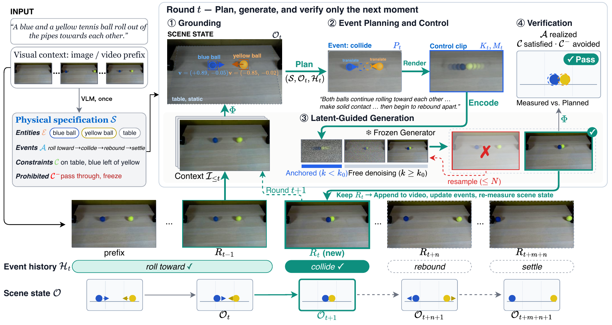

# STEP

Official repository for **Get the Next Moment Right: Short-Term Event Planning for Physically Plausible Video Generation**.

[Project page](https://xdlbw.github.io/STEP/) · Release date 2026.11.24

## Overview

STEP (Short-Term Event Planning) is a training-free, closed-loop framework for improving physical plausibility in generated videos. It guides a frozen video generator one short clip at a time. In each round, STEP estimates the scene state from the latest frames, plans the next physical event, and renders the plan as a control clip. That control guides the next generation step. A verifier checks whether the event occurred and resamples the clip when verification fails.

STEP improves physical plausibility across three frozen generators on Physics-IQ Verified and PhyGenBench.

